# Multimodal Receipt & Invoice Extractor

A robust receipt and invoice extraction system powered by Google Gemini multimodal vision, Pydantic schemas, and multi-tier confidence and arithmetic validation.

---

## Use Case

Extracting key transaction data (merchant, date, currency, line items, tax, and totals) from diverse financial documents—including clear store receipts, degraded/blurry photos, cursive handwritten bills, multilingual transit tickets, and structured invoices—while preventing hallucination and silent failures using per-field confidence scores, uncertainty tracking, and deterministic arithmetic cross-validation.

---

## Features

- **Multimodal LLM Extraction**: Leverages Google Gemini vision (`gemini-3.5-flash`) via the modern `google-genai` SDK with strict JSON schema enforcement.
- **Pydantic Validation**: Strongly typed document modeling with line-item structures and per-field confidence scores (`0.0` to `1.0`).
- **Deterministic Validation Engine**:
  - Rejects non-document images (`document_type == "not_a_document"`).
  - Multi-candidate item-sum matching against subtotal, total, and tax-exclusive net amounts.
  - Tax-inclusive and tax-exclusive sanity checks.
  - Date validation enforcing standard `YYYY-MM-DD` formatting.
  - Automatic confidence bucketing (`high`, `medium`, `low`, `missing`).
- **Interactive Streamlit Web UI**:
  - Live extraction with support for file uploads, image URLs, and pre-loaded sample documents.
  - Prompt version selector (`v1` baseline vs `v2` refined).
  - Color-coded field confidence table with visual warning banners.
  - Full structured JSON download.
- **Batch Evaluation & Prompt Iteration**: CLI runner for bulk testing across sample datasets with automated Markdown reporting and diff tracking.

---

## Tech Stack

- **Multimodal AI**: Google Gemini API via `google-genai` SDK (`gemini-3.5-flash`)
- **Schema Validation & Parsing**: Pydantic v2
- **Web Application**: Streamlit
- **Image Processing**: Pillow (PIL)
- **Environment & Utilities**: python-dotenv, requests, jinja2

---

## Setup & Quickstart

### 1. Clone & Set Up Virtual Environment

```bash
git clone <repo-url>
cd multimodal-receipt-extractor

python -m venv venv
# Windows:
venv\Scripts\activate
# Linux/macOS:
source venv/bin/activate

pip install -r requirements.txt
```

### 2. Configure Environment Variables

Copy `.env.example` to `.env` and insert your Gemini API key:

```bash
cp .env.example .env
```

Ensure `.env` contains:
```ini
GEMINI_API_KEY=your_gemini_api_key_here
GEMINI_MODEL=gemini-3.5-flash
```

### 3. Run Commands

- **Launch Interactive Streamlit UI**:
  ```bash
  streamlit run app.py
  ```
- **Extract a Single Image via CLI**:
  ```bash
  python extractor.py samples/test1.jpg
  ```
- **Extract & Validate a Single Image with Prompt Selection**:
  ```bash
  python validator.py samples/test1.jpg v2
  ```
- **Run Full Batch Evaluation**:
  ```bash
  python run_batch.py v2
  ```
- **Run Single Image in Batch Mode**:
  ```bash
  python run_batch.py v2 hard_blur
  ```

---

## Project Structure

```text
multimodal-receipt-extractor/
├── .env.example
├── .gitignore
├── README.md
├── requirements.txt
├── app.py
├── extractor.py
├── schema.py
├── validator.py
├── run_batch.py
├── docs/
│   ├── failure_case.md
│   ├── prompt_iterations.md
│   └── screenshots/
│       ├── fail_handwritten_v1.png
│       ├── fail_handwritten_v2.png
│       ├── fail_hard_blur_v2.png
│       ├── ui_blurry.png
│       ├── ui_non_receipt.png
│       └── ui_test1.png
├── prompts/
│   ├── v1.txt
│   └── v2.txt
├── results/
│   ├── compare_v1_v2.md
│   ├── v1/
│   │   ├── summary_v1.md
│   │   └── *.json
│   └── v2/
│       ├── summary_v2.md
│       └── *.json
├── samples/
│   ├── SOURCES.md
│   ├── blurry.jpg
│   ├── handwritten.jpg
│   ├── hard_blur.jpg
│   ├── invoice.jpg
│   ├── non_receipt.jpg
│   ├── tamil_hindi.jpg
│   └── test1.jpg
└── tests/
    └── test_validator.py
```

---

## How It Works

```text
┌─────────────────┐       ┌─────────────────┐       ┌──────────────────┐
│  Input Image    │ ───>  │  Gemini Vision  │ ───>  │ Pydantic Receipt │
│ (Upload/Sample) │       │ (System Prompt) │       │   Model Dump     │
└─────────────────┘       └─────────────────┘       └──────────────────┘
                                                              │
                                                              ▼
┌─────────────────┐       ┌────────────────────────────────────────────┐
│  Streamlit UI   │ <───  │              validator.py                  │
│ (Banners/Table) │       │ • Confidence thresholds (LOW 0.6, MID 0.85)│
└─────────────────┘       │ • Multi-candidate items sum verification   │
                          │ • Tax-inclusive & tax-exclusive checks     │
                          │ • Date validation (YYYY-MM-DD)             │
                          │ • Non-document rejection gate              │
                          └────────────────────────────────────────────┘
```

1. **Extraction**: The image is preprocessed (base64-encoded or read as bytes) and dispatched to Gemini with the requested system prompt (`prompts/v1.txt` or `prompts/v2.txt`) alongside the Pydantic `Receipt` response schema.
2. **Schema Ingestion**: Gemini returns strict structured JSON matching `Receipt`, containing extracted line items, totals, tax, confidence metrics, and an `uncertain_fields` list.
3. **Validator Checks**:
   - **Rejection**: If `document_type == "not_a_document"`, extraction is immediately flagged with status `reject`.
   - **Confidence Scoring**: Each field confidence is mapped: `< 0.6` (`low`), `0.6 - 0.85` (`medium`), `>= 0.85` (`high`). Fields with null values are classified as `missing`. If the model flags a field in `uncertain_fields`, any `high` rating is downgraded to `medium`.
   - **Item-Sum Discrepancy**: Sum of line items (`by_qty` and `by_line`) is cross-referenced against candidate totals: `[subtotal, total, (total - tax)]`. If it matches none, the document is flagged for review and both `items` and `total` are downgraded to `low`.
   - **Tax-Inclusive Logic**: If subtotal is close to total (`_close(subtotal, total)`), prices are treated as tax-inclusive; otherwise, `subtotal + tax == total` is enforced.
   - **Date Verification**: Confirms that non-null date strings adhere strictly to ISO `YYYY-MM-DD`.
4. **UI Presentation**: The web interface colors fields based on their validation status (green for high, yellow for medium/uncertain, red for low/mismatched, gray for missing) and displays a top-level alert banner.

---

## Test Results

Evaluated using `prompts/v2.txt` across all 7 test cases:

| Image | Type | Extracted Output (Key Fields) | Status | Correctness Notes |
|---|---|---|---|---|
| 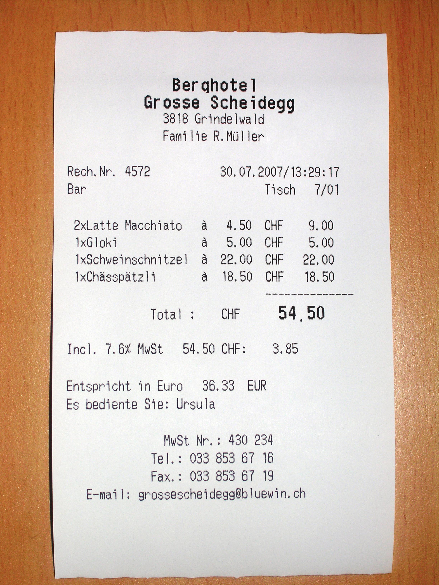 | `receipt` | **Merchant**: Berghotel Grosse Scheidegg<br>**Date**: 2007-07-30<br>**Currency**: CHF<br>**Total**: 54.50 | `ok` | **Correct**. Merchant, date, total (54.50 CHF), tax (3.85 CHF), and all line items match the printed receipt. ([JSON](results/v2/test1.json)) |
| 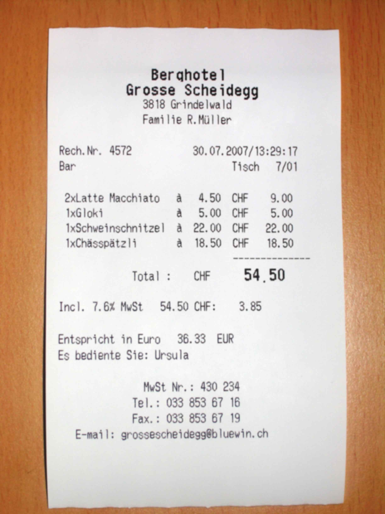 | `receipt` | **Merchant**: Berghotel Grosse Scheidegg<br>**Date**: 2007-07-30<br>**Currency**: CHF<br>**Total**: 54.50 | `ok` | **Correct**. Even with moderate Gaussian blur (radius 3), all key fields and items were extracted without error. ([JSON](results/v2/blurry.json)) |
| 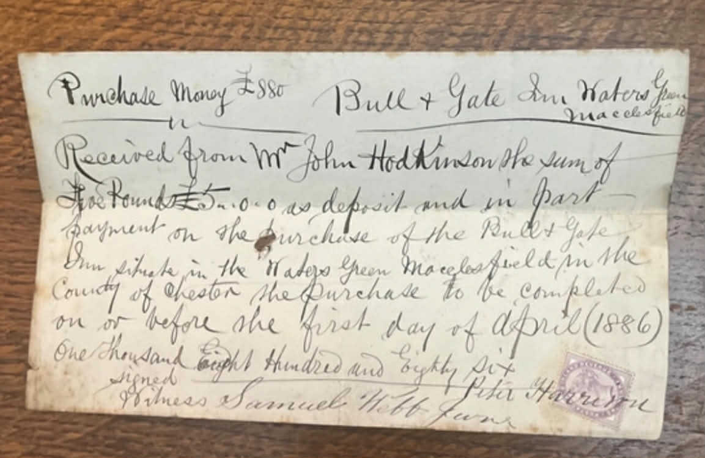 | `receipt` | **Merchant**: Bull & Gate Inn<br>**Date**: null<br>**Currency**: GBP<br>**Total**: null | `review` | **Partly correct**. The merchant and deposit item (£5) were extracted accurately, but `total` returned `null` due to ambiguity between the £5 deposit and £880 purchase price. ([JSON](results/v2/handwritten.json)) |
| 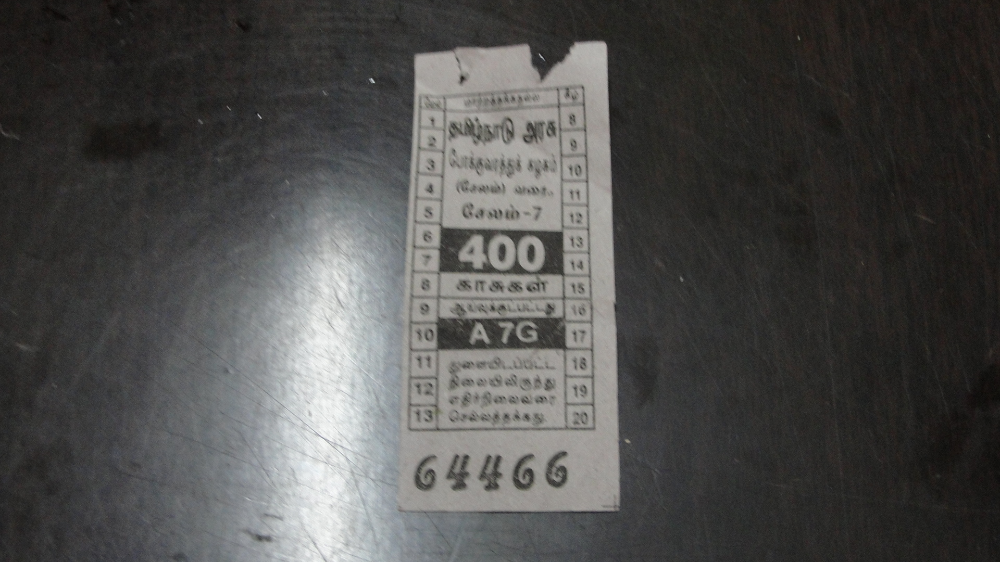 | `receipt` | **Merchant**: தமிழ்நாடு அரசு போக்குவரத்து கழகம்...<br>**Date**: null<br>**Currency**: INR<br>**Total**: 4.0 | `review` | **Correct**. Tamil merchant text was transcribed in original script, and 400 காசுகள் (Paise) was accurately converted to 4.0 INR with notes. ([JSON](results/v2/tamil_hindi.json)) |
| 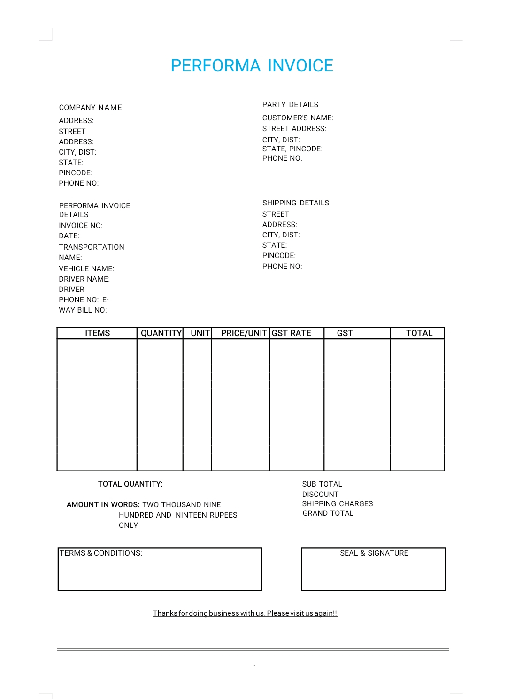 | `invoice` | **Merchant**: null<br>**Date**: null<br>**Currency**: INR<br>**Total**: null | `review` | **Partly correct**. Correctly identified as an invoice template without hallucinating unprinted line items, but missed total printed in words. ([JSON](results/v2/invoice.json)) |
|  | `not_a_document` | **Merchant**: null<br>**Date**: null<br>**Currency**: null<br>**Total**: null | `reject` | **Correct**. Landscape photo accurately classified as `not_a_document` and safely rejected. ([JSON](results/v2/non_receipt.json)) |
| 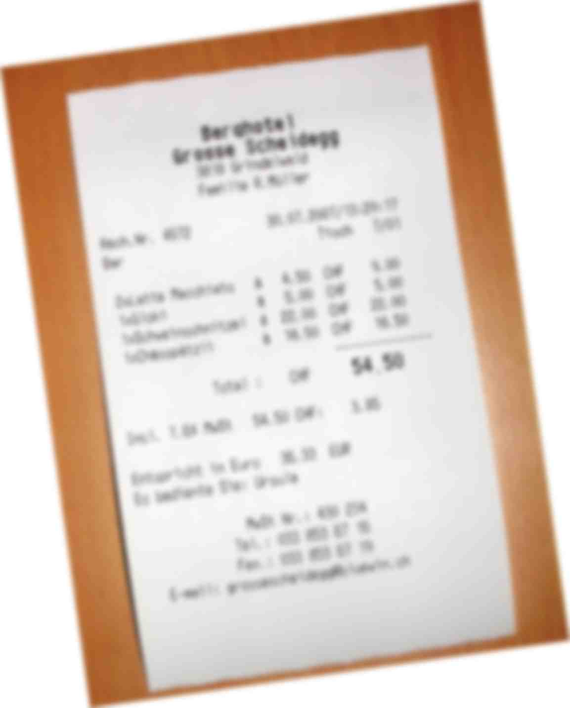 | `receipt` | **Merchant**: Berghotel Grosse Scheidegg<br>**Date**: 2007-07-30<br>**Currency**: CHF<br>**Total**: 54.50 | `review` | **Partly correct**. Total and merchant were recognized despite severe optical blur, but dropped line items triggered an arithmetic mismatch warning. ([JSON](results/v2/hard_blur.json)) |

---

## Failure Case & Uncertainty Handling

A detailed analysis of edge cases and degraded documents is documented in [docs/failure_case.md](docs/failure_case.md).

### Synthetic Severe Degradation (`samples/hard_blur.jpg`)
Under severe blur (`GaussianBlur(radius=5)`, quality 25, 8° rotation), high-frequency character details are erased:
- The model recovered the merchant header and overall total (`54.5 CHF`), but missed one line item and dropped all item names (`name: null`).
- Extracted item prices summed to `48.0 CHF`, contradicting the total of `54.5 CHF`.
- **System Safeguard**: The validator caught the discrepancy (`Item sum (48.0) does not match any of: [54.5]`), highlighted `items` and `total` in red (`low`), flagged model uncertainty, and rendered the `Verify manually` warning banner.

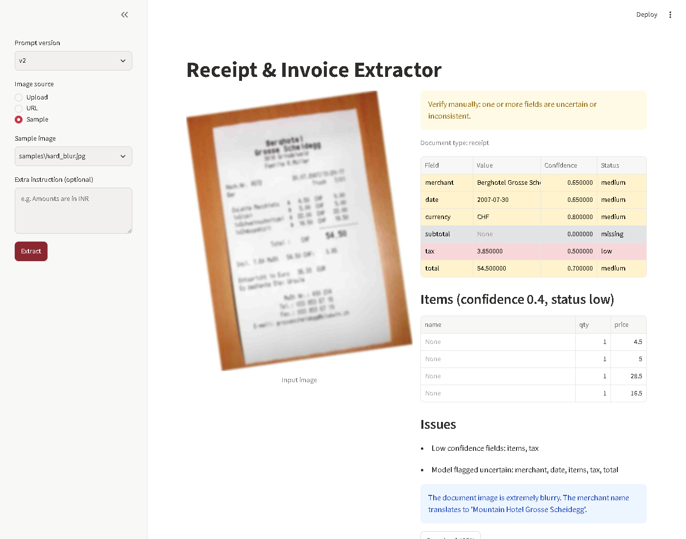

### Cursive Handwriting & Non-Standard Layout (`samples/handwritten.jpg`)
Comparing prompt `v1` vs `v2` on a 19th-century deposit agreement:
- Under `v1`, the model picked up an agreed completion deadline (`1886-04-01`) as the issuance date with confidence `0.7`, and assigned confidence `1.0` to missing tax.
- Under `v2`, strict extraction rules instructed the model to ignore completion deadlines, returning `date: null` (`confidence: 0.0`) and listing `["date", "merchant"]` under `uncertain_fields`.

| Prompt v1 Baseline (`fail_handwritten_v1.png`) | Prompt v2 Refined (`fail_handwritten_v2.png`) |
|:---:|:---:|
| 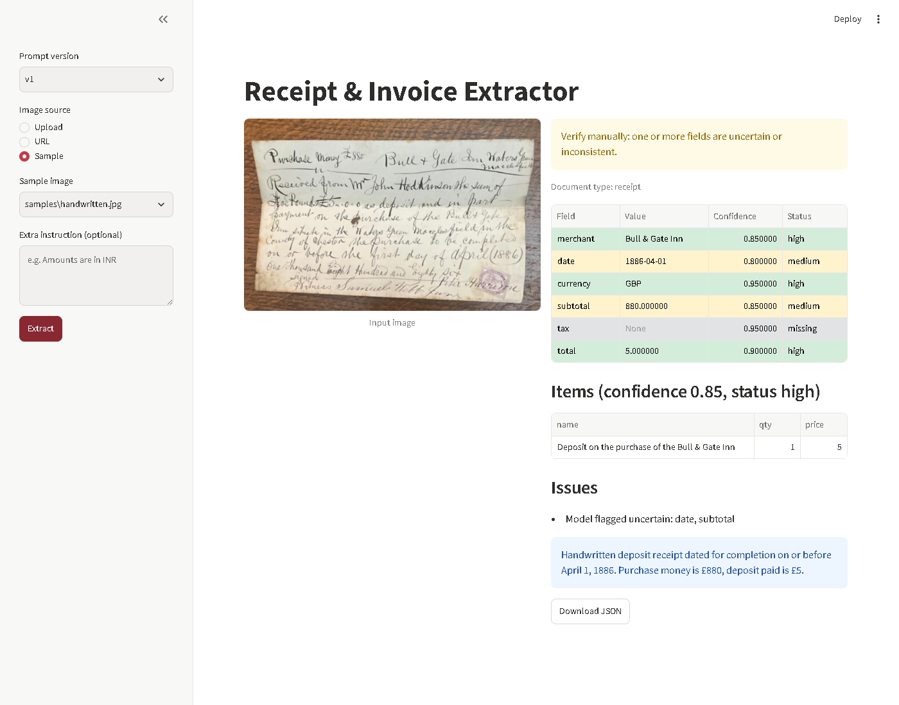 | 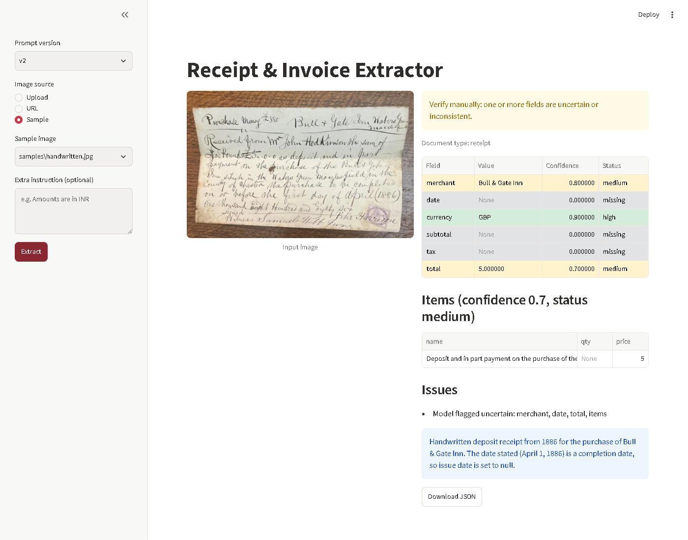 |

---

## Prompt Iterations

Full details of prompt engineering iterations are available in [docs/prompt_iterations.md](docs/prompt_iterations.md).

### Summary of What Changed
1. **Never Calculate or Hallucinate**: Instructed the model never to compute totals on blank invoice forms.
2. **Strict Date Definition**: Mandated that delivery, completion, or due dates must never be captured as transaction dates.
3. **Multilingual Context & Notes**: Required an English translation of non-Latin merchant names in `notes`.
4. **Calibrated Confidence on Nulls**: Explicitly mandated `confidence: 0.0` for any field that is `null`.

### Changes on Edge-Case Documents

| Document | Field | Prompt `v1` (Baseline) | Prompt `v2` (Refined) | Rationale |
|---|---|---|---|---|
| `handwritten.jpg` | `date` | `"1886-04-01"` (`c=0.7`) | `null` (`c=0.0`) | Avoid capturing future completion date as issue date |
| `handwritten.jpg` | `tax` confidence | `1.0` | `0.0` | Stop assigning high confidence to unprinted fields |
| `handwritten.jpg` | `uncertain_fields` | `["date"]` | `["merchant", "date", ...]` | Accurately flag cursive handwriting ambiguity |
| `invoice.jpg` | `total` | `2919.0` | `null` | Stop calculating/inventing total on blank invoice tables |
| `invoice.jpg` | `confidence` | `merchant: 1.0, items: 1.0` | `0.0` for all missing | Zero confidence on blank fields |

---

## UI Screenshots

The Streamlit interface dynamically adjusts its layout and color schemes based on document status:

### 1. Clean Receipt (`samples/test1.jpg`)
All confidence checks pass; fields display green with an `All checks passed` confirmation banner.

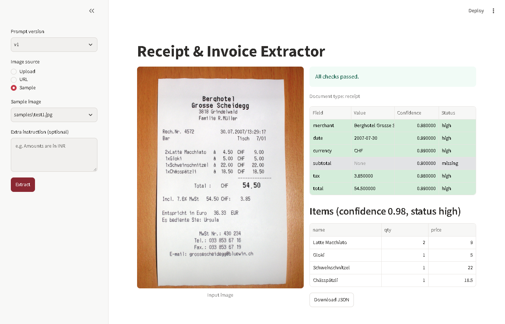

### 2. Degraded / Blurry Receipt (`samples/blurry.jpg`)
Shows robustness against moderate blur, correctly extracting all line items and tax-inclusive totals.

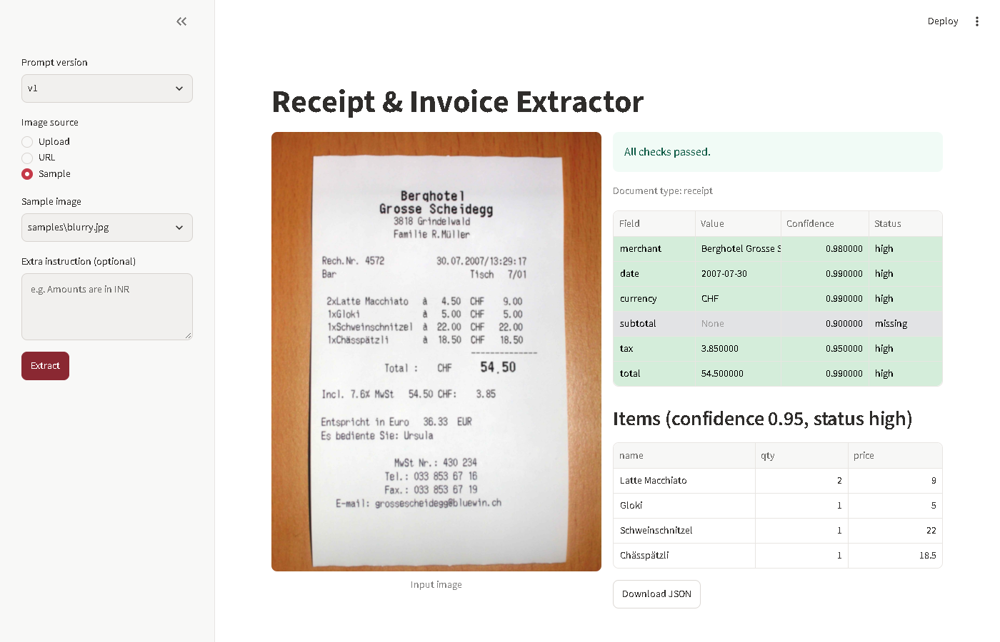

### 3. Non-Document Control Image (`samples/non_receipt.jpg`)
Immediate rejection banner indicating the image is a landscape photo rather than a financial document.

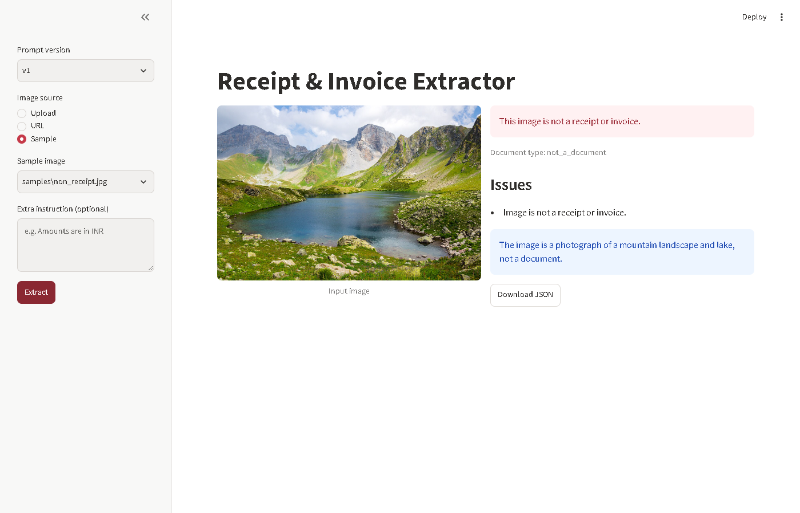

---

## Limitations

- **Stochastic Variations**: Model outputs can vary slightly between runs even at temperature `0.0` (for example, whether `subtotal` on `test1.jpg` or `handwritten.jpg` is returned as `null` or matches `total`).
- **Abstention vs. Extraction Tradeoff**: Refined prompt rules (`v2`) successfully prevent hallucination on blank invoices, but may over-abstain on non-standard receipts where amounts are only stated in words.
- **Uncalibrated Model Confidence**: Self-reported confidence scores from LLMs are heuristic rather than strictly calibrated probabilities; deterministic validator checks are essential.
- **API Latency & Retries**: Transient HTTP `503 Service Unavailable` or `429 Too Many Requests` spikes can introduce 28 to 85 seconds of total execution latency due to exponential retry backoffs (`2 ** attempt * 2`).

---

## Image Attribution & Licenses

All sample images are sourced from open repositories. Full details and source links are documented in [samples/SOURCES.md](samples/SOURCES.md):

- `samples/test1.jpg`: [Wikimedia Commons](https://commons.wikimedia.org/wiki/File:ReceiptSwiss.jpg) — [CC BY-SA 3.0](https://creativecommons.org/licenses/by-sa/3.0/)
- `samples/blurry.jpg`: Synthetically derived from `test1.jpg` via Gaussian blur — [CC BY-SA 3.0](https://creativecommons.org/licenses/by-sa/3.0/)
- `samples/hard_blur.jpg`: Synthetically derived from `test1.jpg` via rotation, downscaling, and blur — [CC BY-SA 3.0](https://creativecommons.org/licenses/by-sa/3.0/)
- `samples/handwritten.jpg`: [Wikimedia Commons](https://commons.wikimedia.org/wiki/File:Macclesfield_Receipt_Bull_and_Gate_Inn.jpg) (by EnglishEnigma1) — [CC BY 4.0](https://creativecommons.org/licenses/by/4.0/)
- `samples/tamil_hindi.jpg`: [Wikimedia Commons](https://commons.wikimedia.org/wiki/File:A_bus_ticket_in_Tamil_Nadu.jpg) (by Thamizhpparithi Maari) — [CC BY-SA 3.0](https://creativecommons.org/licenses/by-sa/3.0/)
- `samples/invoice.jpg`: [Wikimedia Commons](https://commons.wikimedia.org/wiki/File:Performa_invoice_merchandising.jpg) — [CC0 1.0 Universal](https://creativecommons.org/publicdomain/zero/1.0/)
- `samples/non_receipt.jpg`: [Wikimedia Commons](https://commons.wikimedia.org/wiki/File:Zagedan_Lakes,_Mountain_cirque,_Caucasus_Mountains.jpg) — [CC BY 4.0](https://creativecommons.org/licenses/by/4.0/)
