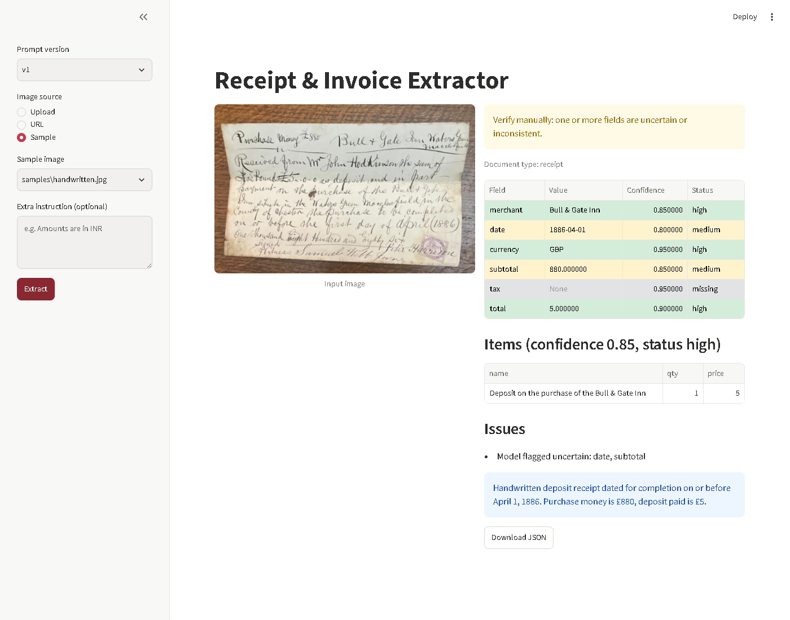
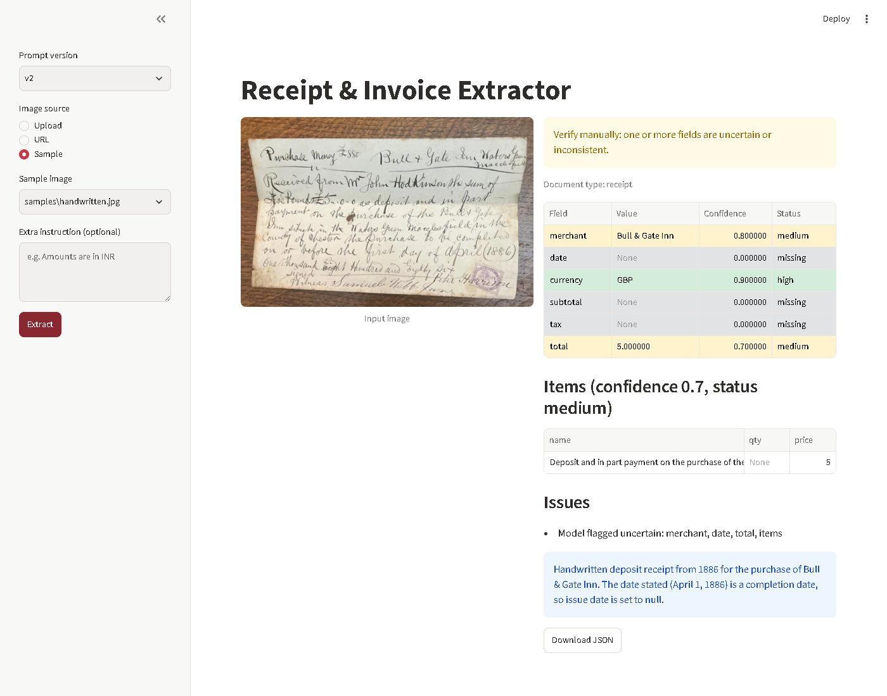
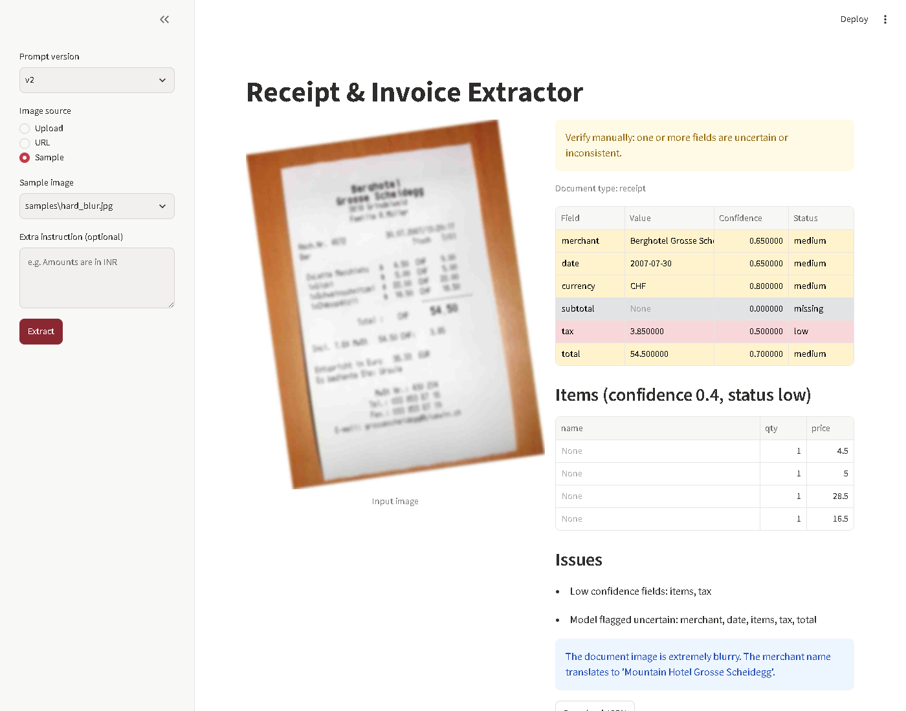

# Deliberate Failure Case Analysis: Degraded & Ambiguous Documents

This document analyzes the deliberate failure and edge cases evaluated with the multimodal receipt extractor, focusing on `samples/hard_blur.jpg` (heavily degraded image) and `samples/handwritten.jpg` (historical cursive handwritten agreement).

---

## 1. Image and Why It Is Hard

### Case A: `samples/hard_blur.jpg` (Synthetic Severe Optical Degradation)
- **Degradation Pipeline**: Generated from `samples/test1.jpg` by downscaling to 40% of original dimensions, rotating 8° with white background fill (`expand=True`), applying `GaussianBlur(radius=5)`, and saving at JPEG quality 25.
- **Why It Is Hard**: The optical blur destroys high-frequency character edges, causing numbers (such as line item prices) to bleed into background noise. Character segmentation is impaired, making individual item names unreadable and causing line-item price misreads or dropped entries.

### Case B: `samples/handwritten.jpg` (19th-Century Cursive Legal Document)
- **Origin**: An 1886 handwritten receipt and deposit contract from the Bull & Gate Inn in Macclesfield.
- **Why It Is Hard**:
  1. **Cursive Script**: Victorian cursive handwriting with variable ink density and stylistic flourishes.
  2. **Non-Standard Structure**: Rather than a modern tabulated receipt, it is an informal written agreement acknowledging a £5 advance deposit towards an £880 property purchase.
  3. **Date Ambiguity**: Mentions a completion deadline (*"first day of April 1886"*) without an explicit printed transaction issuance date.

---

## 2. What the Model Got Wrong or Was Unsure About

### Real Outputs for `samples/hard_blur.jpg` (Prompt `v2`)
- **Dropped Line Items**: The original receipt contains 5 items totaling 54.5 CHF. Due to heavy blur, the model was only able to detect 4 prices: `4.5`, `5.0`, `22.0`, and `16.5`. One line item was missed completely.
- **Unreadable Item Names**: All item names and quantities returned as `null` (`name: null, qty: null`), with item confidence degraded to `0.3`.
- **Arithmetic Discrepancy**: The extracted item prices sum to `48.0 CHF`, which contradicts the extracted total of `54.5 CHF`.
- **Extensive Model Uncertainty**: The model explicitly listed almost all fields in `uncertain_fields`:
  `["merchant", "date", "currency", "items", "tax", "total"]`
  with confidence scores: `merchant: 0.6`, `date: 0.5`, `currency: 0.6`, `items: 0.3`, `total: 0.6`.
- **Model Notes**:
  > *"The image is severely out of focus, making the text extremely blurry. Berghotel Grosse Scheidegg translates to Mountain Hotel Grosse Scheidegg."*

### Real Outputs for `samples/handwritten.jpg` (Prompt `v1` vs `v2`)
- **Under Prompt `v1`**:
  - The model incorrectly assigned `date: "1886-04-01"` (`confidence: 0.7`), treating the completion date clause as the receipt's issuance date.
  - It assigned `subtotal: 5.0` (`confidence: 0.8`) and `tax: null` with `confidence: 1.0` (confident in absence).
  - Only `["date"]` was marked in `uncertain_fields`.
- **Under Prompt `v2`**:
  - `date` returned `null` (`confidence: 0.0`) in accordance with the strict rule: *"Never use due dates, delivery dates or completion dates"*.
  - `merchant` confidence was downgraded to `0.6` due to cursive ambiguity, and both `["date", "merchant"]` were flagged as uncertain.
  - `subtotal` and `tax` returned `null` with `confidence: 0.0`.
  - `notes`: *"Handwritten deposit receipt for £5 towards the purchase of the Bull & Gate Inn (£880 full price). The document specifies a completion date of April 1, 1886, but has no explicit issue date."*

---

## 3. How the App Surfaced It

The validation engine and Streamlit UI prevented silent failure through multi-tiered visual indicators:

1. **Verify-Manually Warning Banner**:
   Instead of a green success check, both failure cases trigger a warning banner:
   > ⚠️ **Verify manually: one or more fields are uncertain or inconsistent.**
2. **Color-Coded Field Table**:
   - **Red / Pink (`#f8d7da` / `low`)**: Highlighted arithmetic mismatch or confidence `< 0.6` (e.g. `date: 0.5`, `items: 0.3`, and `total: 0.6` on `hard_blur.jpg`).
   - **Yellow (`#fff3cd` / `medium`)**: Highlighted fields where the model scored `0.6 <= c < 0.85` or explicitly flagged uncertainty (e.g. `merchant`, `currency`, and `total` on `handwritten.jpg`).
   - **Gray (`#e2e3e5` / `missing`)**: Missing fields like `subtotal` and `tax`.
3. **Issues Section**:
   Explicitly lists all triggered rules:
   - On `hard_blur.jpg`:
     - `- Item sum (48.0) does not match any of: [54.5]`
     - `- Low confidence fields: date, items, total`
     - `- Model flagged uncertain: merchant, date, currency, items, tax, total`
   - On `handwritten.jpg`:
     - `- Model flagged uncertain: date, merchant`
4. **Context Notes Callout**:
   Displays the model's textual caveats regarding severe blur or legal deposit clauses directly below the issues.

---

## 4. Before / After: `v1` vs `v2` Behavior on `handwritten.jpg`

| Metric / Field | Prompt `v1` Baseline | Prompt `v2` Refined | Impact |
|---|---|---|---|
| **`date`** | `"1886-04-01"` (`c=0.7`) | `None` (`c=0.0`) | Eliminates false transaction date inferred from completion deadline |
| **`merchant`** | `"Bull & Gate Inn"` (`c=0.85`) | `"Bull & Gate Inn"` (`c=0.6`) | Down-weights confidence due to cursive handwriting |
| **`total`** | `5.0` (`c=0.85`) | `5.0` (`c=0.7`) | Calibrates deposit vs full contract price (£880) |
| **`uncertain_fields`** | `["date"]` | `["date", "merchant"]` | Surfaces handwriting ambiguity |
| **Null Confidence** | `tax: 1.0` | `tax: 0.0`, `subtotal: 0.0` | Halts overconfident ratings on unprinted fields |
| **Status** | `review` | `review` | Retains safety gate while eliminating false positives |

---

## 5. Honest Limitations

1. **Stochastic Output Variations**: Even with low temperature, multimodal vision models exhibit small variations between runs (e.g., whether `items` or `merchant` is listed in `uncertain_fields` on marginal handwriting).
2. **Abstention vs. Extraction Tradeoff**: Refined prompts with strict abstention rules (`v2`) successfully stop hallucinations on blank invoices, but can occasionally over-abstain on non-standard documents where useful partial context exists.
3. **Severe Optical Distortion**: When Gaussian blur radius exceeds 4-5px, OCR tokenization breaks down and arithmetic cross-checks become the sole defense preventing bad data ingestion.

---

## 6. Embedded UI Screenshots

### Failure Case 1: `samples/handwritten.jpg` under Prompt `v1`

### Failure Case 2: `samples/handwritten.jpg` under Prompt `v2`

### Failure Case 3: `samples/hard_blur.jpg` under Prompt `v2`

